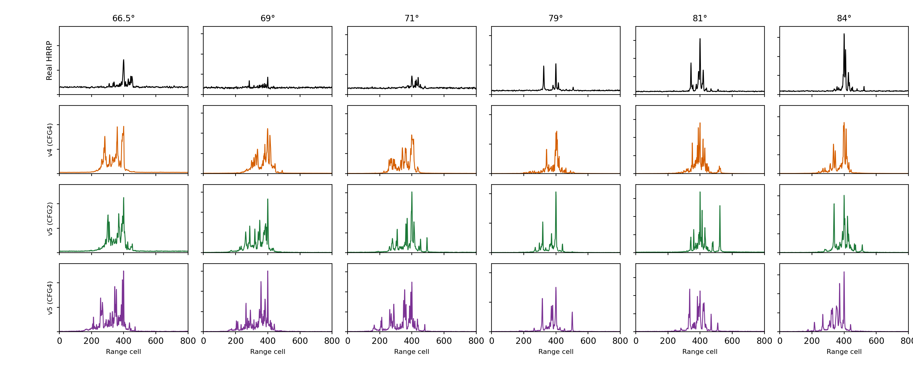
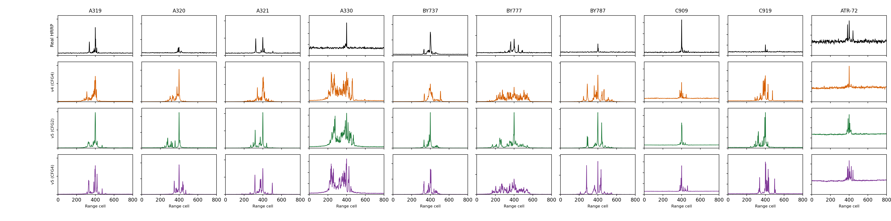
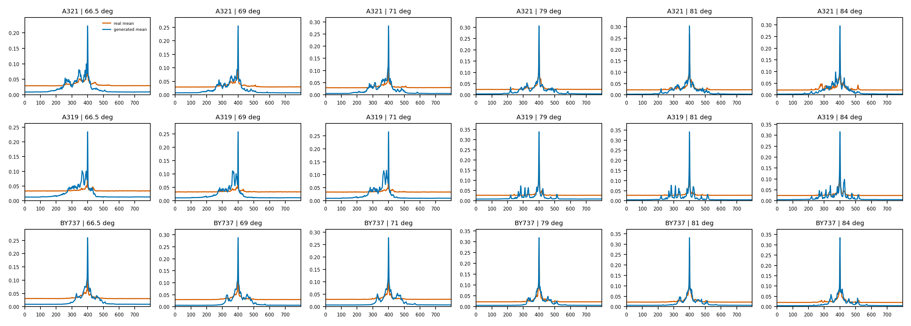
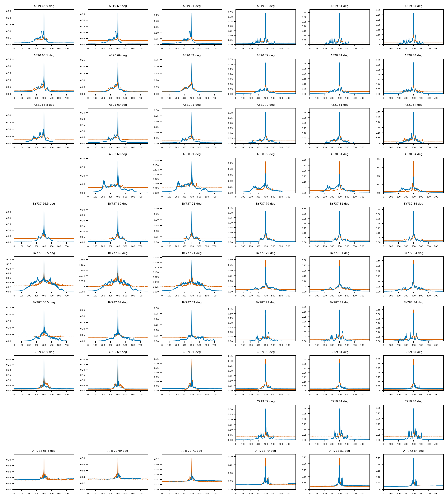

# JiT：类别/目标角条件 HRRP 生成的 DiT（x-prediction + v-loss）

本目录是 HRRP_DiT 项目的 **v5**：在 v4（类别标签 + 目标方位角、绝对 HRRP、
无源 HRRP）的基础上，只把**扩散变量**从 ε 换成 x，把**损失**换成 JiT 的
v-loss；网络、条件注入、数据划分、训练预算和评价协议全部与 v4 相同。

参考：Tianhong Li, Kaiming He, *Back to Basics: Let Denoising Generative
Models Denoise*, arXiv:2511.13720（“Just image Transformers”, JiT）。

## 方法

连续时间 \(t\in[0,1]\)，\(t=1\) 为干净数据：

\[
z_t=t\,x+(1-t)\,\epsilon ,
\]

网络直接预测干净 HRRP \(x_\theta=\mathrm{net}(z_t,t)\)，损失为

\[
v=\frac{x-z_t}{1-t},\qquad v_\theta=\frac{x_\theta-z_t}{1-t},\qquad
\mathcal{L}=\|v_\theta-v\|^2=\frac{\|x_\theta-x\|^2}{(1-t)^2}.
\]

训练时 \(t\sim\mathrm{logit\text{-}normal}(-0.8,0.8^2)\)，分母 \(1-t\) clip
到 0.05；采样用 Euler 50 步，\(t:0\to1\)，CFG 作用在 \(x_\theta\) 上。

与 v4 的唯一区别：

| 项目 | v4 | v5 |
|---|---|---|
| 预测目标 | ε | **x** |
| 前向过程 | DDPM，1000 步离散 t | 连续 flow，\(t\in[0,1]\) |
| 损失 | \(\|\epsilon_\theta-\epsilon\|^2\) | \(\|x_\theta-x\|^2/(1-t)^2\) |
| 采样 | DDIM 50 | Euler 50 |

## 结果

任务：62.5/75/87.5° → 66.5–84°，每类每角 200 条；10 类、800 距离单元。
评价指标：8 个手工特征的逐 cell 直方图 KL、散射功率 KL、MMD、均值剖面
余弦、分类器 top-1。

| CFG | 类别 top-1 ↑ | 8 特征 KL ↓ | 功率 KL ↓ | MMD ↓ | 均值余弦 ↑ | 均值相对 L2 ↓ |
|---:|---:|---:|---:|---:|---:|---:|
| 2.0 | 0.765 | **0.574** | **0.555** | **0.196** | **0.904** | **0.396** |
| 4.0 | **0.892** | 0.791 | 0.704 | 0.266 | 0.861 | 0.480 |

参考：real-vs-real 下界（8 特征 KL / 功率 KL / MMD / 均值余弦）为
0.113 / 0.121 / 0.031 / 0.996；真实测试集分类 top-1 为 0.710。

与 v4 的对比：

| CFG | 版本 | 类别 top-1 ↑ | 8 特征 KL ↓ | MMD ↓ | 均值余弦 ↑ |
|---:|---|---:|---:|---:|---:|
| 2.0 | v4 | 0.456 | **0.456** | **0.183** | 0.911 |
| 2.0 | **v5** | **0.765** | 0.574 | 0.196 | 0.904 |
| 4.0 | v4 | 0.619 | **0.665** | 0.281 | 0.863 |
| 4.0 | **v5** | **0.892** | 0.791 | **0.266** | 0.861 |

主要结论：

- x-pred + v-loss 训练稳定（40k 未发散；v4 在 ~29k 发散）。
- 类别条件大幅提升：CFG4 top-1 0.619 → 0.892，所有类别都提升。
- **v5 CFG2 全面优于 v4 CFG4**（top-1 0.765 vs 0.619、KL 0.574 vs 0.665、
  MMD 0.196 vs 0.281、均值余弦 0.904 vs 0.863）。
- 同 CFG 下分布仍略逊于 v4，主要差在 Fluctuation power 和 Dispersibility。
- CFG4 属于“类别优先”模式：top-1 高于真实测试集，类间被夸大，生成的是
  “夸张的类原型”。

完整表格、逐类 top-1、逐特征分析、角度响应和全部图见
[`RESULTS.md`](RESULTS.md)。

## 图

固定机型 A321、不同目标角（Real / v4 CFG4 / v5 CFG2 / v5 CFG4）：



固定目标角 79°、不同机型（Real / v4 CFG4 / v5 CFG2 / v5 CFG4）：



CFG4 视角网格与均值剖面：





## 目录

```text
JiT/
├── README.md
├── RESULTS.md
├── requirements.txt
├── configs/dit_buaa_jit.yaml   # 训练/采样/评价配置
├── hrrp_dit/                   # 模型、扩散、数据、训练、评价
│   ├── diffusion.py            # 含 JiT flow + v-loss + Euler/Heun 采样
│   ├── model.py                # 1-D DiT-B/8，类别+角度 adaLN
│   ├── data.py                 # .dat 解析、划分、class batcher
│   ├── trainer.py              # 训练、EMA、验证、checkpoint
│   ├── generation.py           # 批量条件采样
│   ├── metrics.py              # 8 特征 KL、功率 KL、MMD、剖面指标
│   └── ...
├── scripts/
│   ├── prepare_data.py
│   ├── train.py
│   ├── sample_class.py
│   ├── evaluate.py
│   └── plot_*.py
└── figures/
```

## 复现

```bash
python -m pip install -r requirements.txt

# 1) 准备 BUAA 缓存（编辑 configs/dit_buaa_jit.yaml 的 data.root）
python scripts/prepare_data.py --config configs/dit_buaa_jit.yaml --force

# 2) 训练（40k steps，batch 128，单卡 4090 约 75 分钟）
python scripts/train.py --config configs/dit_buaa_jit.yaml

# 3) 采样 + 评价（CFG=2）
python scripts/sample_class.py --config configs/dit_buaa_jit.yaml \
    --checkpoint runs/dit_b_class_jit/last.pt --ema --cfg-scale 2.0 \
    --set eval.out_dir=runs/dit_b_class_jit/evaluation_cfg2
python scripts/evaluate.py --config configs/dit_buaa_jit.yaml \
    --generated-dir runs/dit_b_class_jit/evaluation_cfg2

# CFG=4 同理，改 --cfg-scale 4.0 和 eval.out_dir
```

## 说明

- 原始 BUAA 数据不随仓库分发，需要自行提供缓存或原始 `.dat`。
- 训练好的 checkpoint（约 1 GB）超过 GitHub 单文件限制，未包含；可按上面的
  命令从零训练（约 75 分钟），或联系作者获取。
- 本目录是自包含的：运行只依赖 `hrrp_dit/`、`scripts/` 和配置文件，不需要
  HRRP_DiT 的 v1–v4 目录。
- 本目录的 `figures/` 中，`compare_*`、`visual_grid*`、`mean_profiles*`、
  `feature_kl*` 均由 `runs/dit_b_class_jit/` 的正式评价产物生成。
