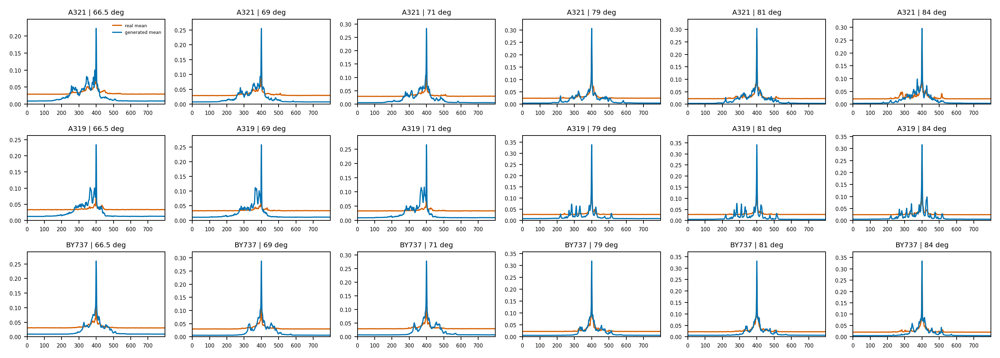
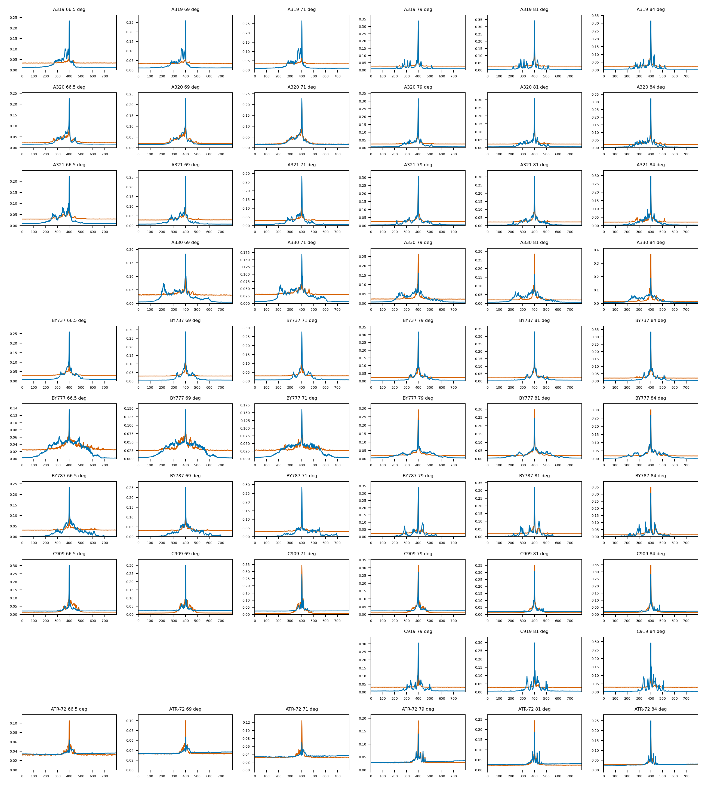
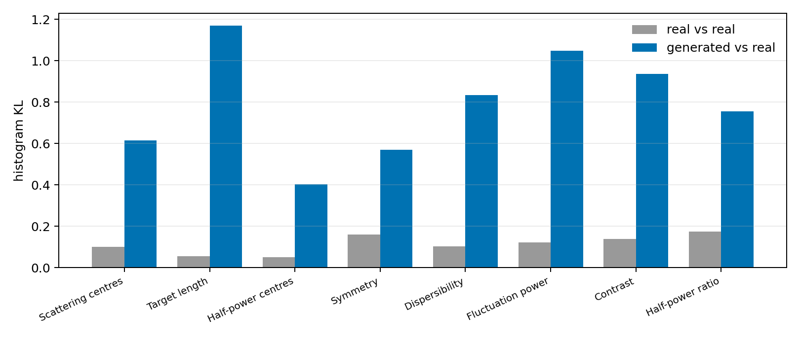
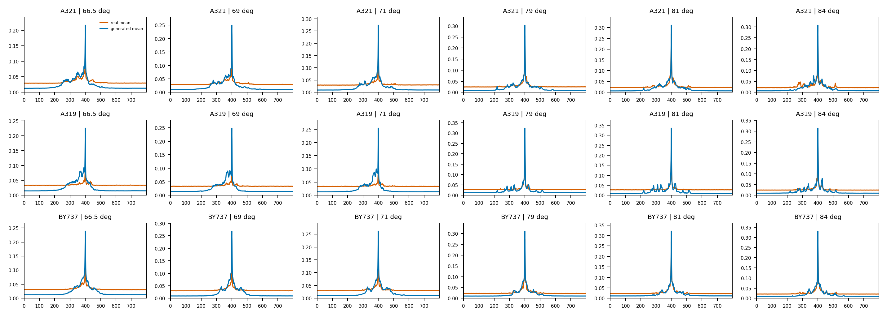
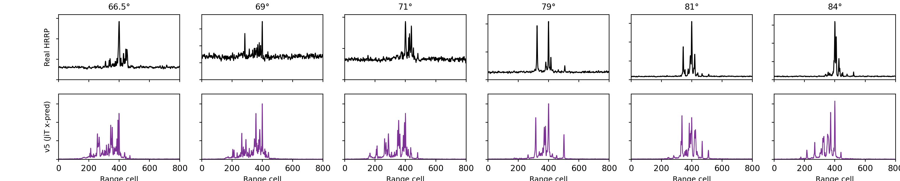
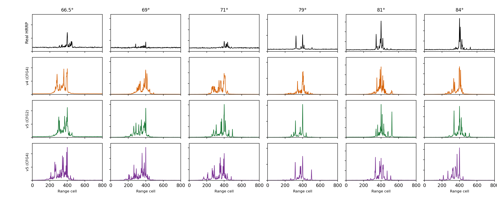
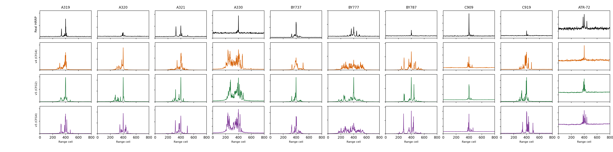
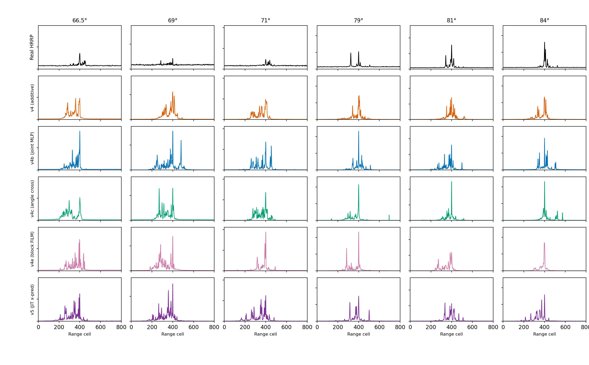
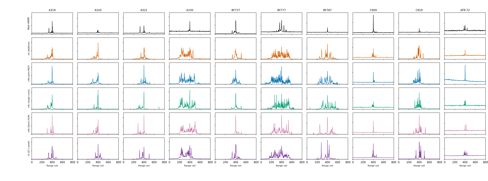

# v5：JiT x-prediction + v-loss（v4 基座）— 实验结果

> 版本：在 **v4（类别标签 + 目标角、绝对 HRRP、无源 HRRP）** 基础上，只把
> **扩散变量**从 ε 换成 x、**损失**换成 JiT 的 v-loss；架构、条件、数据、
> 训练预算和评价协议全部与 v4 相同。
>
> 配置：`configs/dit_buaa_jit.yaml`；产物：`runs/dit_b_class_jit/`。

---

## 1. 训练与稳定性

| 项目 | v5 |
|---|---:|
| 模型 | DiT-B/8，129.7 M，100 tokens，p=8 |
| 扩散变量 | \(z_t=t\,x+(1-t)\epsilon\)，网络预测 \(x\) |
| 损失 | \(\|x_\theta-x\|^2/(1-t)^2\)（v-loss，分母 clip 0.05） |
| t 采样 | logit-normal(−0.8, 0.8²) |
| 采样 | Euler 50 步，\(t:0\to1\) |
| 训练 | 40k steps，batch 128，lr 1e-4，warmup 1k |
| 最佳 | **28k EMA，val 0.16637** |
| 末段 | 40k EMA，val 0.16741 |
| 发散 | **无** |

验证曲线：

| step | 2k | 4k | 6k | 8k | 10k | 14k | 20k | 24k | 28k | 32k | 36k | 40k |
|---|---:|---:|---:|---:|---:|---:|---:|---:|---:|---:|---:|---:|
| val | 2.079 | 0.503 | 0.214 | 0.183 | 0.179 | 0.168 | 0.169 | 0.167 | **0.166** | 0.169 | 0.167 | 0.167 |

14k 后基本平台，40k 无发散。对比 v4 在约 29k 步 loss 爆炸，x-pred + v-loss
在这个设置下明显更稳。注意：v-loss 的数值尺度与 v4 的 ε-loss 不可比。

---

## 2. checkpoint × EMA × CFG 小检查

10 类、每类每角 8 条、50 步 Euler：

| checkpoint | EMA | CFG | 类别 top-1 ↑ | 8 特征 KL ↓ | 均值余弦 ↑ |
|---|---|---:|---:|---:|---:|
| 28k | ✗ | 2.0 | 0.643 | 0.286 | 0.876 |
| 28k | ✗ | 4.0 | 0.768 | 0.318 | 0.824 |
| 28k | ✗ | 5.0 | 0.754 | 0.325 | 0.807 |
| 28k | ✓ | 2.0 | 0.658 | 0.279 | 0.886 |
| 28k | ✓ | 4.0 | 0.855 | 0.314 | 0.841 |
| 28k | ✓ | 5.0 | 0.875 | 0.326 | 0.825 |
| 40k | ✗ | 2.0 | 0.714 | 0.286 | 0.877 |
| 40k | ✗ | 4.0 | 0.862 | 0.323 | 0.829 |
| 40k | ✗ | 5.0 | 0.859 | 0.328 | 0.814 |
| 40k | ✓ | 2.0 | **0.792** | **0.279** | **0.886** |
| 40k | ✓ | 4.0 | **0.915** | 0.315 | 0.841 |
| 40k | ✓ | 5.0 | **0.929** | 0.322 | 0.825 |

40k EMA 最好（虽然 val best 是 28k），正式评价用它。CFG 仍然只放大类别，
不放大角度；CFG 越高类别越准、分布略差。

---

## 3. 完整协议

62.5/75/87.5° → 66.5–84°，每类每角 200 条，50 步 Euler，40k EMA。

| CFG | 类别 top-1 ↑ | 8 特征 KL ↓ | 功率 KL ↓ | MMD ↓ | 均值余弦 ↑ | 均值相对 L2 ↓ |
|---:|---:|---:|---:|---:|---:|---:|
| 2.0 | 0.765 | **0.574** | **0.555** | **0.196** | **0.904** | **0.396** |
| 4.0 | **0.892** | 0.791 | 0.704 | 0.266 | 0.861 | 0.480 |

参考：real-vs-real 下界 8 特征 KL 0.113、功率 KL 0.121、MMD 0.031、
均值余弦 0.996；真实测试集分类 top-1 0.710，扇区真实参考约 0.616。

---

## 4. 与 v4 系列对比

| CFG | 版本 | 类别 top-1 ↑ | 8 特征 KL ↓ | 功率 KL ↓ | MMD ↓ | 均值余弦 ↑ | 均值相对 L2 ↓ |
|---:|---|---:|---:|---:|---:|---:|---:|
| 2.0 | v4 | 0.456 | 0.456 | 0.500 | 0.183 | 0.911 | 0.392 |
| 2.0 | v4b | 0.341 | 0.423 | 0.498 | 0.171 | 0.914 | 0.381 |
| 2.0 | v4c | 0.318 | **0.388** | **0.478** | **0.165** | 0.916 | 0.380 |
| 2.0 | v4e | 0.331 | 0.397 | 0.481 | 0.167 | **0.918** | — |
| 2.0 | **v5** | **0.765** | 0.574 | 0.555 | 0.196 | 0.904 | 0.396 |
| 4.0 | v4 | 0.619 | 0.665 | 0.648 | 0.281 | 0.863 | 0.496 |
| 4.0 | v4b | 0.460 | 0.608 | 0.654 | 0.262 | 0.865 | 0.486 |
| 4.0 | v4c | 0.403 | **0.534** | **0.597** | **0.241** | **0.875** | **0.472** |
| 4.0 | v4e | 0.434 | 0.555 | 0.622 | 0.252 | 0.874 | 0.472 |
| 4.0 | **v5** | **0.892** | 0.791 | 0.704 | 0.266 | 0.861 | 0.480 |

**v5 的类别 top-1 大幅领先（CFG4：0.619 → 0.892；CFG2：0.456 → 0.765），
但 8 特征 KL 变差（CFG4：0.665 → 0.791；CFG2：0.456 → 0.574）。**

更重要的是 **v5 CFG=2 全面优于 v4 CFG=4**：

| 指标 | v4 CFG4 | v5 CFG2 |
|---|---:|---:|
| 类别 top-1 ↑ | 0.619 | **0.765** |
| 8 特征 KL ↓ | 0.665 | **0.574** |
| 功率 KL ↓ | 0.648 | **0.555** |
| MMD ↓ | 0.281 | **0.196** |
| 均值余弦 ↑ | 0.863 | **0.904** |
| 均值相对 L2 ↓ | 0.496 | **0.396** |

也就是说，换 x-pred + v-loss 后，**不需要把 CFG 拉到 4** 就能同时得到更好的
类别正确率和更好的分布。CFG=4 则把类别推到 0.892，但分布回到 v4 CFG4 水平。

---

## 5. 逐类 top-1

| 类别 | v4 CFG4 | v5 CFG2 | v5 CFG4 |
|---|---:|---:|---:|
| A319 | 0.360 | 0.574 | **0.838** |
| A320 | 0.450 | 0.630 | **0.763** |
| A321 | 0.451 | 0.678 | **0.883** |
| A330 | 0.816 | 0.875 | **0.942** |
| BY737 | 0.696 | 0.828 | **0.931** |
| BY777 | 0.788 | 0.803 | **0.928** |
| BY787 | 0.748 | 0.913 | **0.988** |
| C909 | 0.669 | 0.788 | **0.878** |
| C919 | 0.192 | 0.700 | **0.878** |
| ATR-72 | 0.840 | 0.844 | **0.894** |

即使 CFG=2，所有类别也都高于 v4；原本最弱的 A319、C919 提升最大。

---

## 6. 为什么类别变好、分布变差

1. **类间被夸大**：生成剖面的类均值之间余弦，CFG4 为 **0.8535**、CFG2 为
   **0.9167**，真实是 **0.9469**（v4 CFG4 为 0.855）。CFG 越高，类间越
   “拉开”，分类器越容易分对，但离真实分布越远。
2. **类内并没有坍塌**：同 cell 样本对余弦 CFG4 0.765、CFG2 0.767，真实
   0.8966，生成样本比真实更多样。
3. **特征分布**（同 cell 生成/真实 std 中位数）：

   | 特征 | v5 CFG4 | v5 CFG2 | v5 CFG4 mean | v5 CFG2 mean |
   |---|---:|---:|---:|---:|
   | Scattering centres | 0.683 | **0.939** | 0.528 | **0.932** |
   | Target length | 0.589 | **0.815** | 0.551 | **0.795** |
   | Half-power centres | 0.154 | 0.261 | 0.728 | **0.914** |
   | Symmetry | 0.810 | **0.926** | 0.750 | **0.898** |
   | Dispersibility | 0.872 | **1.007** | 1.369 | 1.052 |
   | Fluctuation power | 1.077 | 1.167 | 1.146 | 1.223 |
   | Contrast | 0.777 | **0.950** | 1.509 | 1.083 |
   | Half-power ratio | 0.919 | **1.039** | 1.754 | 1.130 |

   CFG=2 时大多数特征的标准差和均值都接近真实；仍偏窄的是
   Half-power centres，仍偏宽的是 Fluctuation power。CFG=4 则明显
   过窄、能量过度集中。
4. **逐特征 KL**：

   | 特征 | v4 CFG2 | v5 CFG2 | v4 CFG4 | v5 CFG4 |
   |---|---:|---:|---:|---:|
   | Scattering centres | **0.431** | 0.522 | 0.586 | 0.614 |
   | Target length | **0.736** | 0.758 | 1.200 | 1.170 |
   | Half-power centres | **0.243** | 0.268 | 0.301 | 0.404 |
   | Symmetry | **0.372** | 0.401 | 0.561 | 0.569 |
   | Dispersibility | **0.425** | 0.614 | 0.650 | 0.834 |
   | Fluctuation power | **0.366** | 0.878 | 0.454 | 1.048 |
   | Contrast | **0.602** | 0.647 | 0.894 | 0.937 |
   | Half-power ratio | **0.473** | 0.500 | 0.671 | 0.756 |

   同样 CFG 下 v4 的分布仍略好；v5 的主要代价是 **Fluctuation power**
   （起伏过强）和 **Dispersibility**（峰间距分布不对）。

5. **均值剖面**：和 v4 一样，生成均值在 range cell ≈400 有一个固定强峰，
   而真实均值更平坦（真实剖面的主峰位置在样本间变化更大）。这是
   label-only 模型共同的伪影，不是 v5 新增的。

---

## 7. 角度响应

| 指标 | 真实 | v4 CFG4 | v5 CFG4 | v5 CFG2 |
|---|---:|---:|---:|---:|
| 2.5° 相邻角均值余弦 | 0.984 | 0.994 | **0.982** | 0.989 |
| 宽扫描相邻角余弦（30–150°） | 0.976 | 0.927 | **0.891** | 0.914 |
| 宽扫描端点余弦 | 0.935 | 0.887 | 0.865 | 0.877 |

在 2.5° 细网格上 v5 与真实几乎一致（CFG4 0.982、CFG2 0.989，真实 0.984）；
在 30–150° 宽扫描上，v5 比真实和 v4 都更“敏感”（余弦更低），角度变化
被放大，CFG4 最明显。CFG2 的角度响应比 CFG4 更接近真实。

---

## 8. 结论

- **x-pred + v-loss 显著提升了类别条件能力**，并且训练比 v4 稳定（40k 未
  发散）；这是 v5 最明确的收益。
- **CFG=2 是 label-only 下目前最好的综合折中**：top-1 0.765、8 特征 KL
  0.574、MMD 0.196、均值余弦 0.904，**全面优于 v4 CFG=4**
  （0.619 / 0.665 / 0.281 / 0.863）。
- **但同 CFG 下分布仍不如 v4**：CFG2 时 v4 的 8 特征 KL 0.456 优于 v5 的
  0.574；v5 的代价集中在 Fluctuation power（起伏过强）和 Dispersibility。
- **CFG=4 是“类别优先”模式**：top-1 0.892 已明显高于真实测试集 0.710，
  说明生成的是“夸张的类原型”；类间余弦 0.854 对真实 0.947，分布也明显
  变差。用于训练分类器可能教出对类间差异过敏感的模型。
- 对“生成数据”的用途：
  - 类别正确、类间可分优先：**v5 CFG2**（不要用 CFG4）。
  - 波形级真实感优先：v5 没有解决问题，仍应优先考虑源条件模型或特征
    条件化 / 分布匹配。
- 下一步：把 v5 的 x-pred + v-loss 与**特征条件化**结合，目标是同时保住
  v5 CFG2 的类别能力和接近 v4 CFG2 的分布。

---

## 9. 图











固定机型 A321，不同目标角：Real / v4 CFG4 / v5 CFG2 / v5 CFG4



固定目标角 79°，不同机型：Real / v4 CFG4 / v5 CFG2 / v5 CFG4



固定 A321，按目标角比较 Real / v4 / v4b / v4c / v4e / v5：



固定目标角 79°，按机型比较 Real / v4 / v4b / v4c / v4e / v5：



---

## 10. 复现

```bash
cd HRRP_DiT

python3 scripts/train.py --config configs/dit_buaa_jit.yaml

python3 scripts/sample_class.py --config configs/dit_buaa_jit.yaml \
    --checkpoint runs/dit_b_class_jit/last.pt --ema --cfg-scale 4.0 \
    --set eval.out_dir=runs/dit_b_class_jit/evaluation
python3 scripts/evaluate.py --config configs/dit_buaa_jit.yaml \
    --generated-dir runs/dit_b_class_jit/evaluation

# CFG=2
python3 scripts/sample_class.py --config configs/dit_buaa_jit.yaml \
    --checkpoint runs/dit_b_class_jit/last.pt --ema --cfg-scale 2.0 \
    --set eval.out_dir=runs/dit_b_class_jit/evaluation_cfg2
python3 scripts/evaluate.py --config configs/dit_buaa_jit.yaml \
    --generated-dir runs/dit_b_class_jit/evaluation_cfg2
```
